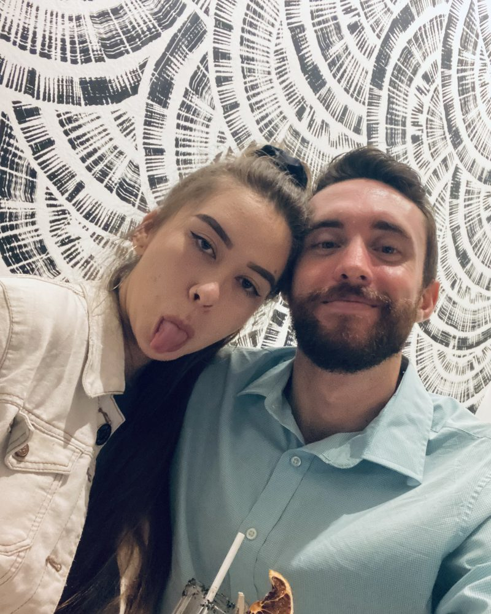

# John & Ani wedding site

Static site for the wedding on Sunday, September 5, 2027 at Heʻeia State Park. It is served at `manionjohn.com/wedding/` by GitHub Pages from this repo, and is built to move to its own domain later by changing one config value.

Nothing on the personal site links here.

## Files

| Path | What it is |
|---|---|
| `index.html` | The main page: home, story, schedule, venue, travel, attire, registry, FAQ |
| `rsvp/index.html` | RSVP page (placeholder until Phase 2) |
| `assets/site.css` | All styles. Colors and fonts are tokens at the top |
| `assets/site.js` | Phone menu and countdown |
| `assets/config.js` | Generated from `site.config.json`. Don't edit by hand |
| `assets/fonts/` | Self-hosted Young Serif and Nunito Sans, with their OFL licenses |
| `assets/img/` | Photos (empty for now) |
| `og-image.png` | Picture shown when the link is texted or posted |
| `site.config.json` | Site URL, wedding date, ceremony start, contact email, RSVP settings |
| `build.mjs` | Writes config values into the pages and checks for hardcoded paths |
| `tools/` | Source for the link preview image and icons |
| `TODO.md` | Every `[TBD]` placeholder still on the site |

## Editing content

Edit `index.html` directly. Placeholders look like this and show up highlighted in yellow on the page:

```html
<span class="tbd">[TBD] RSVP deadline</span>
<p class="tbd-block">[TBD] Dress code</p>
```

Replace the whole span or paragraph with the real text. `grep -rn "\[TBD\]" wedding` lists what's left.

All links between pages and to assets are relative (`rsvp/`, `assets/site.css`, `../`). Keep them that way: a link starting with `/` would break when the site moves to its own domain. `node build.mjs --check` catches those.

## Config and the build step

`site.config.json` holds the values that are absolute or shared between pages:

| Field | Used for |
|---|---|
| `siteUrl` | Canonical and Open Graph URLs. The one value to change when the site moves |
| `weddingDate` | Countdown |
| `ceremonyStart` | Countdown to the minute once set, e.g. `2027-09-05T16:30:00-10:00` |
| `contactEmail` | Footer on every page, and the RSVP "not found" message in Phase 2 |
| `rsvpEndpoint` | Apps Script web app URL (Phase 2) |
| `rsvpDeadline` | When the RSVP form closes (Phase 2) |

After changing it:

```sh
cd wedding
node build.mjs           # updates the pages and assets/config.js
node build.mjs --check   # run before pushing; fails if anything is stale or hardcoded
```

The build only rewrites the text between `<!-- build:NAME -->` and `<!-- /build:NAME -->` markers. It needs Node 18 or newer and has no dependencies.

## Photos

Photos go in `assets/img/`. Before adding one, strip its location data (phone photos usually carry GPS coordinates) and resize it to about 1600px on the long side. Then replace a placeholder in the story section:

```html
<figure>
  
  <figcaption>Caption</figcaption>
</figure>
```

## Link preview image and icons

`og-image.png`, `assets/favicon-32.png` and `assets/apple-touch-icon.png` are rendered from `tools/og-image.html` and `assets/favicon.svg`:

```sh
node tools/render-images.mjs   # needs Playwright
```

## Privacy

- Every page has `<meta name="robots" content="noindex, nofollow">`, and the site-wide `robots.txt` at the repo root disallows `/wedding/`.
- The repo is public. Never commit the guest list, home addresses, phone numbers, or the venue contract.
- No analytics or tracking. The map is an OpenStreetMap embed, which sets no cookies.

## Fonts

Young Serif (headings) and Nunito Sans (body) are both under the SIL Open Font License. They were picked because they include the ʻokina (U+02BB) and the kahakō vowels. Fraunces, used elsewhere on manionjohn.com, has no ʻokina. Write the ʻokina as the real character `ʻ`, not an apostrophe or a curly quote.

## Deploying

Merge to `main`. GitHub Pages publishes within a minute or two.
